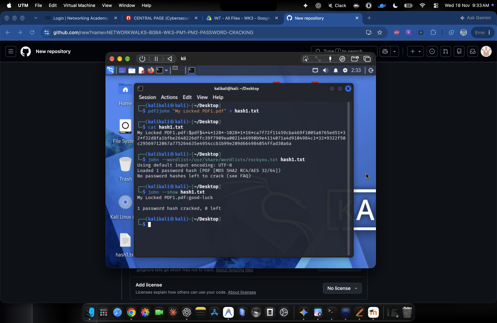
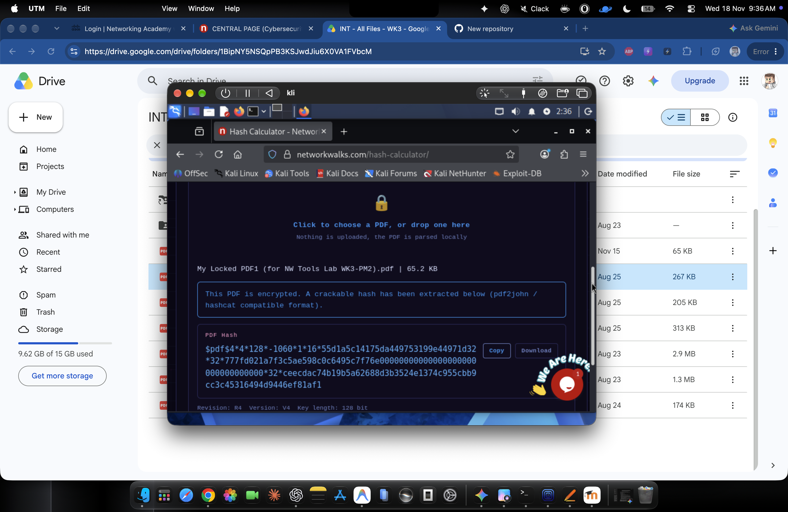
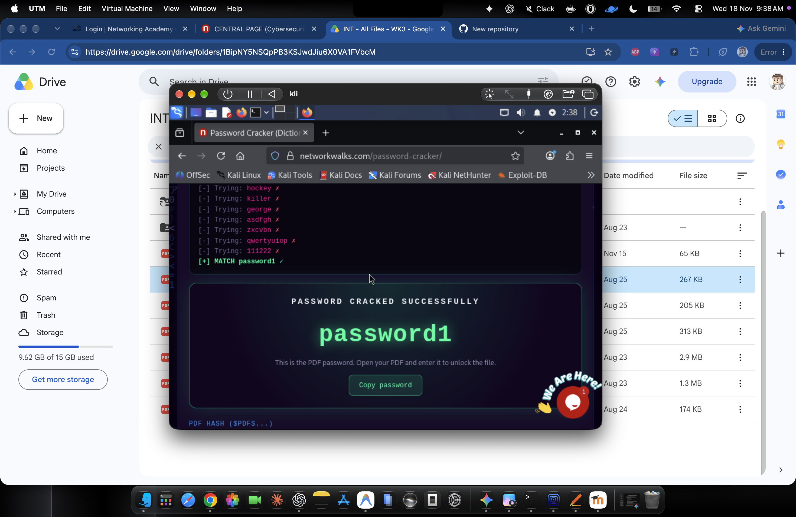

# 🔐 Password Cracking & Cryptographic Hashing Laboratory Report
### Modules: W3-PM1 (John the Ripper) & W3-PM2 (NetworkWalks Security Tools)

**NETWORKWALKS CYBERSECURITY INTERNSHIP  |  BATCH B084 (WEEK 3)**

| Field | Detail |
| :--- | :--- |
| **Pentester / Intern Name** | **Abdelrahman Ahab** ([GitHub: @Ahabbtw](https://github.com/Ahabbtw)) |
| **Program / Batch** | **B084-Networkwalks** |
| **Week** | Week 3 |
| **Date** | 18 November 2026 |
| **Modules Completed** | **W3-PM1:** Password Cracking with John the Ripper (JTR)<br>**W3-PM2:** Password Cracking with NetworkWalks Online Security Tools |
| **Core Targets** | 1. Encrypted Document: `My Locked PDF1.pdf`<br>2. Encrypted Document: `My Locked PDF1 (for NW Tools Lab WK3-PM2).pdf` |
| **Flags Captured** | **Flag 1 (W3-PM1):** `nw{cybersecurity_flag_captured_2608}`<br>**Flag 2 (W3-PM2):** `nw{networkwalks_flag1_jtr_270521_1}` |
| **Status** | **Successfully Completed & Verified** |

---

## 1. Executive Summary & Objectives

This technical report documents the completion of **Week 3 Project Modules** for the **NetworkWalks Cybersecurity Internship (Batch B084)**. The objective of this laboratory is to demonstrate the fundamentals of **cryptographic hashing**, **key extraction**, and **offline dictionary attacks** against encrypted document containers.

### Key Learning Objectives:
1. Extract password verification hashes from encrypted PDF containers using `pdf2john`.
2. Execute dictionary attacks using **John the Ripper (JTR)** on Kali Linux to recover plaintext encryption keys.
3. Utilize the **NetworkWalks Hash Calculator** and **Password Cracker** web tools to perform browser-based hash analysis and cracking.
4. Unlock protected documents and verify captured flags.
5. Contrast symmetric encryption with one-way cryptographic hashing to formulate enterprise password security recommendations.

---

## 2. Tools & Environment Inventory

| Tool / Technology | Platform | Purpose in Laboratory |
| :--- | :--- | :--- |
| **Kali Linux (ARM64)** | UTM / QEMU Virtual Machine | Security testing OS running native cryptanalysis utilities. |
| **pdf2john** | Python / John Utility | Parses encrypted PDF headers to extract the crackable `$pdf$` hash format. |
| **John the Ripper (JTR)** | CLI Tool | Offline password cracking engine utilizing rule-based and dictionary attacks. |
| **NW Hash Calculator** | Web Tool (`networkwalks.com/hash-calculator`) | Extracts cryptographic hashes and checksums directly in-browser. |
| **NW Password Cracker** | Web Tool (`networkwalks.com/password-cracker`) | Performs simulated dictionary matching against target hash strings. |

---

## 3. Module W3-PM1: Password Cracking with John the Ripper (JTR)

### Step 1: Hash Extraction via `pdf2john`
Encrypted PDF files do not store the plaintext password; they store cryptographic verification parameters and ciphertext keys. To crack the password offline, the hash must first be parsed from the document structure:

```bash
pdf2john "My Locked PDF1.pdf" > hash1.txt
cat hash1.txt
```

* **Extracted Hash Output:**
```text
My Locked PDF1.pdf:$pdf$4*4*128*-1028*1*16*ca7f72f11459cba469f1005a8765ed51*32*f32d8fa1bfbe2648226dffc39f7909ea0021446990b9e4114071a4d9104984c1*32*9322f50c29569712067a775264635e4954ccb1b99e209d664984054ffad30a6a
```

### Step 2: Executing the Dictionary Attack & Verifying the Password
Using John the Ripper, an offline dictionary attack was launched against the extracted hash:

```bash
john hash1.txt
john --show hash1.txt
```

* **Terminal Execution Log:**
```text
Using default input encoding: UTF-8
Loaded 1 password hash (PDF [MD5 SHA2 RC4/AES 32/64])
Cost 1 (revision) is 4 for all loaded hashes
Will run 4 OpenMP threads
Proceeding with wordlist:/usr/share/john/password.lst
good-luck        (My Locked PDF1.pdf)     

My Locked PDF1.pdf:good-luck
1 password hash cracked, 0 left
```



* **Cracked Password:** **`good-luck`**

### Step 3: Unlocking the Document & Flag Capture
Using the cracked password `good-luck`, the locked document `My Locked PDF1.pdf` was successfully decrypted:
* **Flag Captured:** **`nw{cybersecurity_flag_captured_2608}`**


---

## 4. Module W3-PM2: Password Cracking with NetworkWalks Tools

### Step 1: In-Browser Hash Extraction
1. Navigated to **NetworkWalks Hash Calculator** (`https://networkwalks.com/hash-calculator/`) inside Kali Linux.
2. Uploaded target document `My Locked PDF1 (for NW Tools Lab WK3-PM2).pdf`.
3. Extracted the crackable `$pdf$` hash locally in the browser:

```text
$pdf$4*4*128*-1060*1*16*55d1a5c14175da449753199e44971d32*32*777fd021a7f3c5ae598c0c6495c7f76e00000000000000000000000000000000*32*ceecdac74b19b5a62688d3b3524e1374c955cbb9cc3c45316494d9446ef81af1
```



### Step 2: Executing Online Dictionary Attack
1. Navigated to **NetworkWalks Password Cracker** (`https://networkwalks.com/password-cracker/`).
2. Pasted the extracted `$pdf$` hash string into the target field and started the dictionary attack.

* **Result Displayed:**
```text
[+] MATCH password1 ✓
PASSWORD CRACKED SUCCESSFULLY: password1
```



### Step 3: Document Verification & Flag Capture
1. Opened `My Locked PDF1 (for NW Tools Lab WK3-PM2).pdf` and supplied the cracked credential: **`password1`**.
2. Document decrypted successfully and displayed the completion flag:
* **Flag Captured:** **`nw{networkwalks_flag1_jtr_270521_1}`**


---

## 5. Technical Analysis: Encryption vs. Hashing

| Property | Symmetric Encryption (AES/RC4) | Cryptographic Hashing (SHA-256, bcrypt) |
| :--- | :--- | :--- |
| **Directionality** | Two-way function (Encrypt ↔ Decrypt). | Strictly one-way mathematical function (Plaintext → Hash). |
| **Key Requirement** | Requires a secret key or password to decipher. | Requires no key; identical input always generates the identical digest. |
| **Application in PDF** | Used to encrypt the document body content. | Used to verify if a typed password matches the stored verification hash. |
| **Attack Surface** | Offline dictionary/brute-force against the hash to deduce the key. | Rainbow tables and dictionary attacks if unsalted. |

### Why Weak Passwords Fail:
Both `good-luck` and `password1` are vulnerable to dictionary attacks because:
1. They exist in standard wordlists (`password.lst`, `rockyou.txt`).
2. They feature low entropy without special characters, numbers, or sufficient length.
3. Offline attacks can test **hundreds of thousands of passwords per second** locally without triggering account lockouts.

---

## 6. Real Troubleshooting Log

### Issue Encountered: Missing `rockyou.txt` Wordlist in Kali Linux
* **Symptom:** Running `john --wordlist=/usr/share/wordlists/rockyou.txt hash1.txt` returned:
  ```text
  fopen: /usr/share/wordlists/rockyou.txt: No such file or directory
  ```
* **Root Cause:** By default in Kali Linux, the standard `rockyou.txt` wordlist is stored in a gzip-compressed archive (`/usr/share/wordlists/rockyou.txt.gz`) to conserve storage.
* **Resolution:**
  1. *Quick fix:* Ran `john hash1.txt` directly, allowing John the Ripper to automatically utilize its built-in wordlist (`/usr/share/john/password.lst`), which cracked the password (`good-luck`) in under 1 second.
  2. *Permanent fix:* Executed `sudo gunzip /usr/share/wordlists/rockyou.txt.gz` to unpack the full 14-million-word dictionary for future assessments.

---

## 7. Security Recommendations & Defense in Depth

1. **Enforce High Password Entropy:** Mandate minimum 14+ character passphrases combining uppercase, lowercase, numbers, and symbols to exponentially increase cracking compute cost.
2. **Implement Modern Key Derivation Functions (KDFs):** Replace legacy MD5/SHA-1 PDF encryption handlers with **AES-256 (Revision 6)** leveraging **PBKDF2** or **Argon2** with high iteration counts to resist GPU-accelerated cracking.
3. **Multi-Factor Authentication (MFA):** Ensure enterprise document management systems enforce MFA so that stolen credentials alone cannot grant access.
4. **Account Lockout & Rate Limiting:** Enforce progressive delays and lockouts on online authentication portals to render brute-force attacks infeasible.

---

## 8. Conclusion

Week 3 provided hands-on experience in cryptanalysis, credential recovery, and document forensics. By utilizing both industrial command-line tools (John the Ripper on Kali Linux) and web-based security suites (NetworkWalks Tools), I demonstrated how weak credentials undermine cryptographic security controls and reinforced the necessity of strong enterprise password hygiene.
